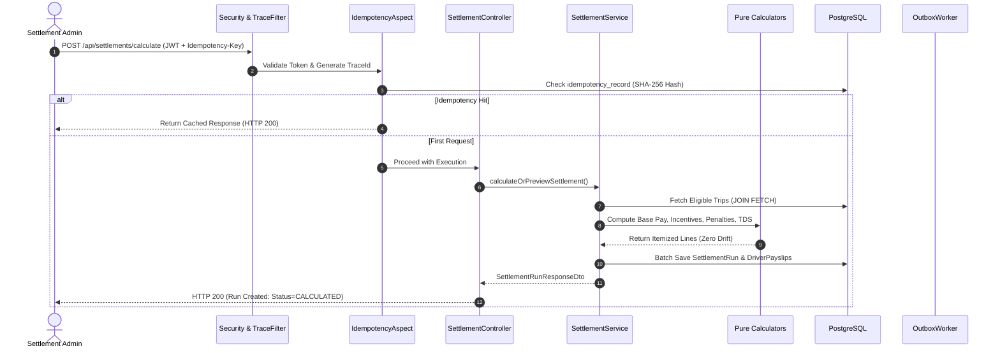
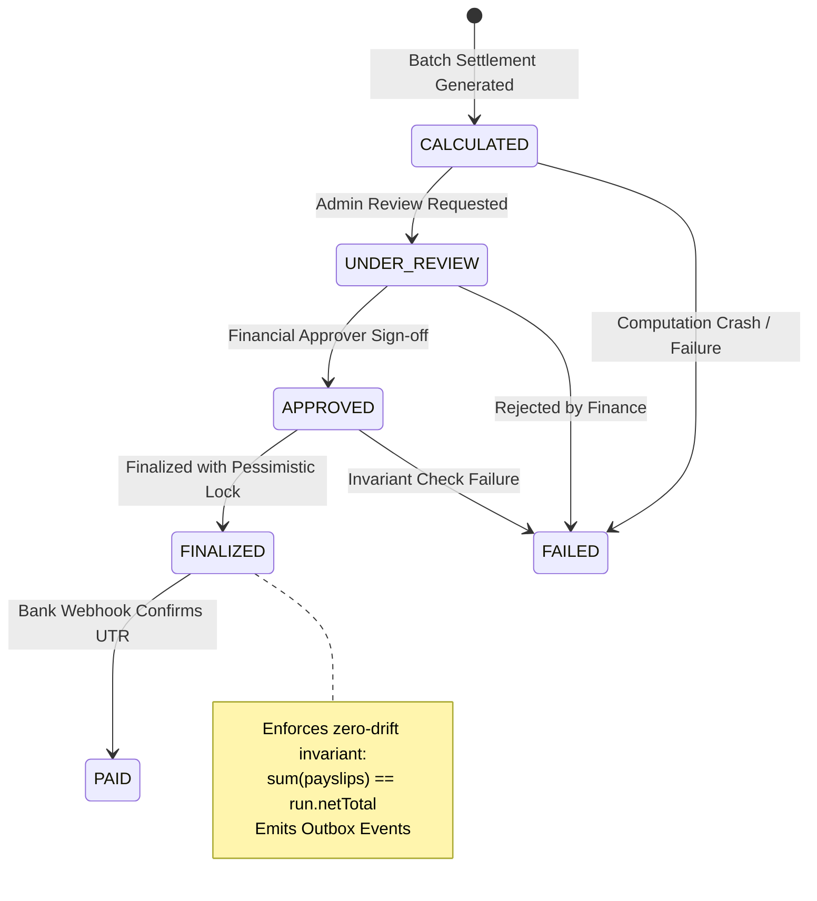

# MoveInSync Settlement Engine — Architecture Walkthrough Guide

## 1. How to Present the System in 5 Minutes (Presentation Script)

> **Opening (30 seconds):**
> *"Our project solves the high-volume, mission-critical financial challenge in corporate employee transportation: paying transport vendors and drivers accurately, on time, with zero mathematical drift, and full audit compliance. We engineered an enterprise settlement engine built on Java 21, Spring Boot, and PostgreSQL 16."*

> **Component Breakdown (90 seconds):**
> *"The architecture is structured into 4 decoupled layers:
> 1. **Security & Perimeter:** Stateless JWT authentication with fine-grained RBAC across 4 roles, distributed MDC trace correlation (`X-Trace-Id`), and an RFC 7807 global exception handler.
> 2. **Financial Math Core:** Pure, stateless SRP calculators evaluating base trip pay from time-sliced rate schedules, performance bonuses, capped safety deductions, and Section 194C statutory TDS withholding using exact `BigDecimal` arithmetic.
> 3. **Orchestration & Idempotency:** Two-tier protection preventing duplicate billing through cryptographic SHA-256 request payload hashing and database partial unique indexes, with an ephemeral preview mode.
> 4. **Payout Lifecycle & Outbox:** A strict 5-state machine backed by pessimistic row locking (`FOR UPDATE`) and a Transactional Outbox worker using PostgreSQL `SKIP LOCKED` for horizontally scalable, non-blocking bank disbursement."*

> **Reconciliation & Disputes (60 seconds):**
> *"Beyond batch calculation, we provide closed-loop financial controls:
> - **Three-Way Reconciliation:** Automatically compares vendor tax invoices against MoveInSync ledgers using an absolute ₹50 tolerance rule.
> - **Append-Only Dispute Deltas:** When trips are contested, historical settlement records remain 100% immutable. The engine calculates strictly the delta difference (Revised - Original) and disburses an adjustment payout."*

> **Closing & Metrics (30 seconds):**
> *"The engine handles 10,000 commute trips across 50 drivers in 95 milliseconds with exact 0.00 paise drift, backed by 58 automated unit/integration tests and automated CI."*

---

## 2. Request Data Flow

---

## 3. Payout State Machine Flow

