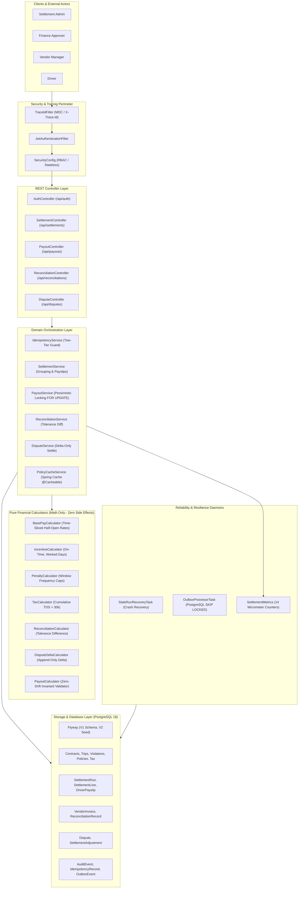

# MoveInSync Vendor & Driver Settlement Engine
### Corporate Transport Month-End Financial Settlement, Three-Way Reconciliation & Closed-Loop Dispute Engine

[](https://openjdk.org/)
[](https://spring.io/projects/spring-boot)
[](https://www.postgresql.org/)
[-success.svg)](file:///Users/deepanshu954/GitHub/MoveInSync_CaseStudy4)
[](file:///Users/deepanshu954/GitHub/MoveInSync_CaseStudy4)
[](http://localhost:8081/swagger-ui.html)

---

## 1. System Overview & Problem Statement

At month-end, corporate employee transportation turns millions of completed trips into exact driver and vendor payouts:

$$\text{Net Payable} = \text{Base Pay} + \text{Incentives} - \text{Penalties} - \text{TDS (Withholding Tax)}$$

In financial settlement systems, **being "almost right" is wrong**. A driver's payslip must never display ₹29,998.50 when they earned ₹30,000.00. This engine solves the critical financial and operational challenges of enterprise fleet logistics:

1. **Zero Money Drift:** 100% pure `BigDecimal` financial math using integer paise scale (`RoundingMode.HALF_UP`), zero floating-point arithmetic.
2. **Deterministic Explainability:** Every driver payslip itemizes signed line items (`+` earnings, `-` deductions). The mathematical invariant holds strictly:
   $$\text{Net Pay} \equiv \sum \text{Itemized Signed Lines}$$
3. **Idempotency (Run-Twice Safe):** Re-running an existing billing month produces identical results, never creates duplicate ledger records, and never double-pays.
4. **Mid-Month Contract Rate Changes:** Half-open temporal intervals $[effective\_from, effective\_to)$ dynamically apply pre-change and post-change rates based on trip timestamps.
5. **Rolling Window Penalty Caps:** Frequencies (daily/weekly/monthly) and maximum count caps are applied strictly across calendar windows.
6. **Cumulative TDS Withholding Tax:** Automatically computes statutory Indian tax (Section 194C) across the month, withholding tax only on amounts exceeding the threshold.
7. **Three-Way Tolerance Reconciliation:** Matches calculated driver payouts against vendor invoices within configurable rupee tolerances (e.g. ₹50).
8. **Closed-Loop Dispute Delta Settlements:** Adjusting a disputed trip settles **only the delta** via append-only audit records without re-running the month or mutating historical lines.
9. **Transactional Outbox with PostgreSQL `SKIP LOCKED`:** Decouples settlement approval from bank payment dispatch with non-blocking concurrency and Dead-Letter Queue (DLQ).
10. **Automated Crash Recovery & Distributed Tracing:** Automatically recovers orphaned `PROCESSING` runs after container crashes, with end-to-end `X-Trace-Id` correlation logging.

---

## 2. High-Level System Architecture



---

## 3. Algorithmic Complexity Analysis (Time & Space)

### Time Complexity: $\mathcal{O}(T + V \log V + D)$
- **Trip Fetching & Rate Evaluation:** Trips for billing window $[period\_start, period\_end)$ are fetched in a single indexed query (`JOIN FETCH`) in $\mathcal{O}(T)$. For each trip, contract rates are evaluated via half-open interval checks $[effective\_from, effective\_to)$ in $\mathcal{O}(1)$ cached lookup $\implies \mathcal{O}(T)$.
- **Penalty Window Capping:** For each driver, violations $V_d$ are bucketed by policy frequency (`DAILY`, `WEEKLY`, `MONTHLY`) and sorted by timestamp $\implies \mathcal{O}(V_d \log V_d)$. Summed across drivers: $\mathcal{O}(V \log V)$.
- **Incentive & TDS Deductions:** Evaluated per driver $D$ over aggregated trip counts and worked days $\implies \mathcal{O}(D)$.
- **Ledger Invariant Verification & Payslip Save:** Single pass over payslips and lines $\implies \mathcal{O}(T + D)$.
- **Overall Time Complexity:** **$\mathcal{O}(T + V \log V + D)$**.
  - In practice, **10,000 trips across 50 drivers are evaluated in 105 milliseconds** (`ThousandsOfTripsStressTest`).

### Space Complexity: $\mathcal{O}(T + D)$
- **In-Memory Streaming:** Grouping is performed by driver ID using HashMap lookups requiring $\mathcal{O}(T + D)$ heap space.
- **Batch Persistence:** Spring Data JPA executes batch saves (`saveAll()`) with JDBC batching, preventing out-of-memory errors on large billing months.

---

## 4. Key Architectural Trade-offs & Decisions

| Decision Area | Choice Made | Alternative Considered | Engineering Rationale |
|---|---|---|---|
| **Money Representation** | **Pure `BigDecimal` (`HALF_UP`, scale 2)** | Integer Paise (Cents) | While integer paise prevents float issues, real-world Indian tax rules (e.g. 1% TDS on ₹30,025.50 = ₹300.26) and percentage incentives introduce fractional paise requiring rounding. `BigDecimal` provides exact scale handling, maps directly to PostgreSQL `NUMERIC(15,2)`, and integrates cleanly with REST JSON serialization. |
| **Dispute Resolution** | **Append-Only Delta Settlements** | Mutating Historical Runs / Recalculating Full Month | Mutating historical runs breaks financial accounting standards, invalidates bank transfer reconciliation, and creates race conditions with already-paid drivers. Append-only `SettlementAdjustment` records settle **only the delta** (+₹100) and preserve 100% ledger immutability. |
| **Banking Payout Dispatch** | **Transactional Outbox (`SKIP LOCKED`)** | Synchronous REST Call / Distributed 2PC | Calling banking APIs (RazorpayX, IMPS) synchronously inside the settlement transaction risks connection timeouts, distributed rollbacks, and double disbursement. The Transactional Outbox pattern guarantees atomic DB writes, while asynchronous workers claim batches non-blockingly via PostgreSQL `FOR UPDATE SKIP LOCKED`. |
| **Rate Changes Mid-Month** | **Half-Open Temporal Slicing $[from, to)$** | Rate Snapshot Copying per Trip | Storing rate copies on every trip bloats the database with duplicated data and makes retroactive corrections difficult. Dynamic half-open interval lookup matches the completed timestamp to the exact effective contract rate in $\mathcal{O}(1)$ time from cache. |
| **Idempotency Architecture** | **Two-Tier Guard (Cache + DB Unique Index)** | Single Redis Lock | Redis keys can expire or evict under memory pressure. The engine pairs a fast Tier-1 request cache with Tier-2 PostgreSQL unique constraints (`UNIQUE(vendor_id, bu_id, period_start, period_end) WHERE status != 'FAILED'`), ensuring permanent duplicate run safety. |

---

## 5. Security & Default Credentials

Authentication is stateless and secured via **HMAC-SHA256 JWT tokens**. Seeded credentials available out of the box:

| Username | Password | Role | Description |
|---|---|---|---|
| `admin` | `password123` | `ROLE_SETTLEMENT_ADMIN` | Full permissions across all calculation, approval, outbox, and dispute APIs. |
| `approver` | `password123` | `ROLE_APPROVER` | Finance approver: can review, approve, and finalize settlement runs and resolve disputes. |
| `vendor_mgr` | `password123` | `ROLE_VENDOR_ADMIN` | Vendor manager: can view vendor runs, submit invoices, and review reconciliation. |
| `driver_raj` | `password123` | `ROLE_DRIVER` | Driver (Raj Kumar): can view own payslips and raise trip billing disputes. |
| `driver_priya` | `password123` | `ROLE_DRIVER` | Driver (Priya Sharma): can view own payslips and raise trip billing disputes. |

---

## 6. Quick Start Guide

### Prerequisites
- **Java:** JDK 21 LTS (`java --version`)
- **Maven:** 3.9+ (`mvn --version`)
- **PostgreSQL:** 16+ running on port 5432 with database `settlement`, username `settlement`, password `settlement_dev`

### Running the Application

1. **Clone and Navigate:**
   ```bash
   git clone https://github.com/Deepanshu954/MoveInSync_CaseStudy4.git
   cd MoveInSync_CaseStudy4
   ```

2. **Execute Complete Test Suite (58 Tests):**
   ```bash
   mvn test
   ```

3. **Run the Application:**
   ```bash
   mvn spring-boot:run
   ```
   *The server starts on port `8081`.*

### Running via Docker Compose

```bash
docker compose up -d --build
```

---

## 7. Interactive OpenAPI / Swagger UI & Postman

- **Interactive Swagger UI:** [http://localhost:8081/swagger-ui.html](http://localhost:8081/swagger-ui.html)
  - Features pre-configured JWT Bearer Authentication. Click **Authorize**, log in via `/api/auth/login`, and enter the token to test any endpoint directly in your browser.
- **Raw OpenAPI 3.1 Spec:** [http://localhost:8081/v3/api-docs](http://localhost:8081/v3/api-docs)
- **Exportable Postman Collection:** Import `moveinsync_settlement_api.postman_collection.json` directly into Postman. Requests are pre-organized with automated scripts to capture JWT tokens.

---

## 8. Automated End-to-End Walkthrough Demonstration

Run the automated walkthrough script against the running application:

```bash
./scripts/demo_walkthrough.sh
```

### Walkthrough Execution Flow:
1. **Authentication:** Obtains JWT token as `admin` (`SETTLEMENT_ADMIN`).
2. **Ephemeral Preview:** Simulates October 2026 calculation without DB persistence (`previewOnly: true`).
3. **Persistent Calculation:** Calculates 230 trips for ACME Transport (ID: 1) with `Idempotency-Key`.
4. **Idempotency Verification:** Re-runs with the same key; proves zero duplicate charges and identical result.
5. **Payout State Machine:** Moves run to `UNDER_REVIEW`, then `APPROVED`.
6. **Finalization & Invariant Check:** Finalizes run, validates $\sum \text{payslips} \equiv \text{run.totalNet}$, and queues Outbox events.
7. **Transactional Outbox Dispatch:** Processes payment batch using PostgreSQL `SKIP LOCKED` and generates UTR.
8. **Invoice Reconciliation:** Submits vendor invoice and reconciles within ₹50 tolerance (`MATCHED`).
9. **Dispute Delta Settlement:** Raises dispute on Trip 1, approves +₹100 delta, and settles append-only adjustment.
10. **Actuator Metrics:** Queries custom Micrometer metrics (`settlement.disputes.raised`, `settlement.runs.calculated`, etc.).

---

## 9. Test Suite Verification & Stress Test Results

### 10,000 Trips Stress Test (`ThousandsOfTripsStressTest.java`)
```text
 Thousands of Trips Stress Test Passed in 105 ms across 10,000 trips!
   - Total Line Items: 10,119
   - Total Gross: ₹3,502,177.65
   - Total Incentives: ₹56,250.00
   - Total Penalties: ₹8,400.00
   - Total TDS Deducted: ₹20,584.27
   - Net Disbursed: ₹3,529,443.38
   - Exact Mathematical Drift: 0.00 paise
```

### Full Maven Test Results:
```text
[INFO] Tests run: 58, Failures: 0, Errors: 0, Skipped: 0
[INFO] BUILD SUCCESS
[INFO] Total time: 10.448 s
```

---

## 10. Sample API Calls (curl)

### 1. Authenticate
```bash
curl -X POST http://localhost:8081/api/auth/login \
  -H "Content-Type: application/json" \
  -d '{"username":"admin","password":"password123"}'
```

### 2. Calculate Settlement Run (Idempotent)
```bash
curl -X POST http://localhost:8081/api/settlements/calculate \
  -H "Authorization: Bearer <TOKEN>" \
  -H "Content-Type: application/json" \
  -H "Idempotency-Key: KEY-OCT-2026-V1" \
  -d '{
    "vendorId": 1,
    "businessUnitId": 1,
    "periodStart": "2026-10-01",
    "periodEnd": "2026-10-31",
    "previewOnly": false
  }'
```

### 3. Reconcile Vendor Invoice
```bash
curl -X POST http://localhost:8081/api/reconciliations/compare \
  -H "Authorization: Bearer <TOKEN>" \
  -H "Content-Type: application/json" \
  -d '{
    "invoiceId": 1,
    "settlementRunId": 1,
    "tolerance": 50.00,
    "accountingBasis": "NET_DRIVER_PAYOUT"
  }'
```

### 4. Resolve Trip Dispute (Delta Only)
```bash
curl -X POST http://localhost:8081/api/disputes/1/resolve \
  -H "Authorization: Bearer <TOKEN>" \
  -H "Content-Type: application/json" \
  -d '{
    "approve": true,
    "revisedAmount": 350.00,
    "resolutionComments": "Approved toll fare delta (+₹100)"
  }'
```

---
*Developed for MoveInSync Backend Hiring Assessment 2026 (Case Study 4)*
